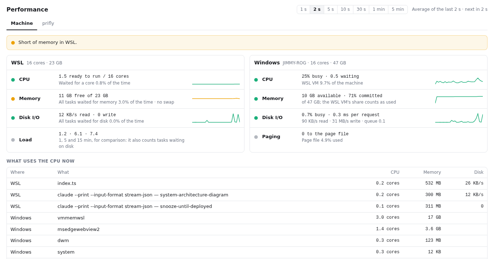
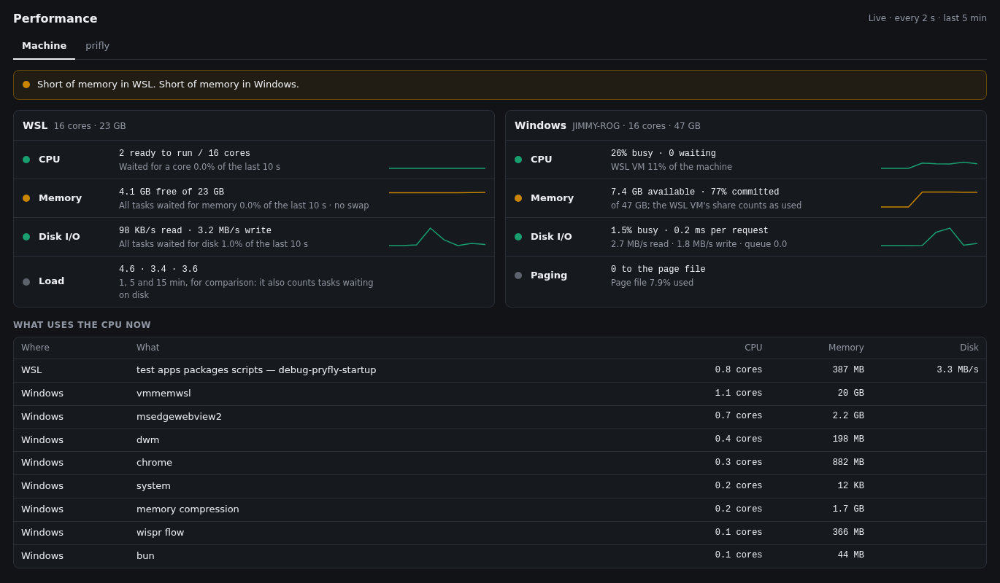
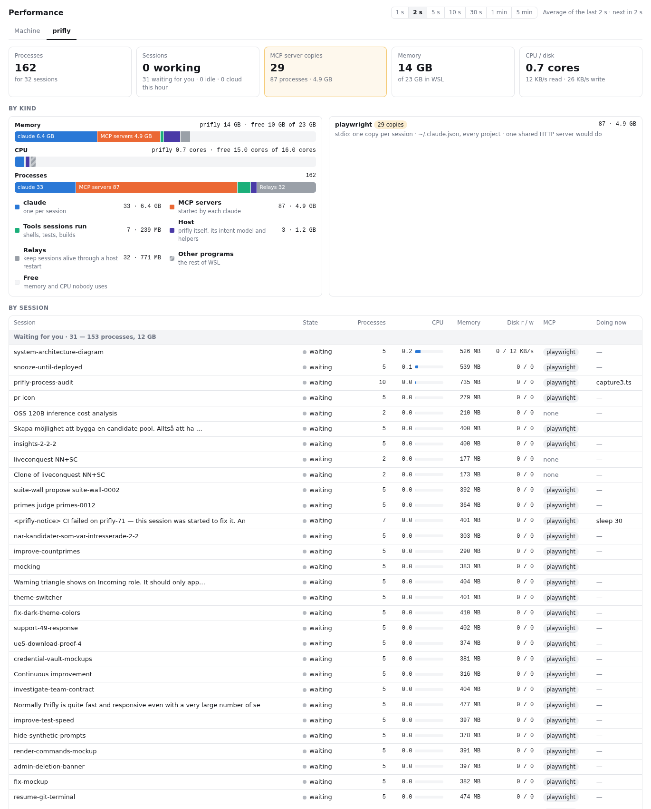

# Performance for prifly

Is this machine out of CPU, memory or disk, and what is using it? This
extension answers that in green, orange and red, for WSL and for the Windows
around it. A second tab answers the same question for prifly itself: how many
processes it runs, for which sessions, and how many MCP servers those sessions
started.

It adds one item to prifly's status bar: a **Performance** button whose icon
is green, orange or red for the worst of CPU, memory and disk over the last
10 s. Hover it for what is short ("Out of CPU in WSL") and each resource's
colour; click it for the window below, over nearly the whole of prifly. The
window's ↗ button opens it in a window of its own. (A prifly from before
2026-10-01 shows the colour as a separate chip beside the button.)



## Every second, or every five minutes

The window has a control for the period it averages over: 1 s, 2 s, 5 s, 10 s,
30 s, 1 min or 5 min (2 s to begin with, and it remembers your choice). It
repaints every second whatever the period, each time with the average of the
trailing period, and says so: *Average of the trailing 30 s, updated every
second*. So the numbers move every second but hold still: two repaints of a
30 s period share 29 of their seconds, and a 2 s spike counts for a fifteenth.
Before a period has filled it averages what there is and says so (*Average of
the last 8 s*).

- **Rates are exact.** CPU (per process, session and kind, and in total),
  disk read and write, and Linux's busy share are the change of a cumulative
  counter between the window's start and its end, over the time between. A
  process born mid-window counts what it used since its first sample, spread
  over the whole window; one that ended inside it is gone from the table.
- **Levels are means.** Available memory, the run queue, swap, load, the
  pressure figures (the kernel's own 10 s averages, averaged again) and
  Windows' counters are the mean of the one-second samples in the window.
- **Colours and the headline** are judged from the averaged numbers.
- **Sparklines** have one point per window: the last 60 that fit in the last
  hour.
- The status-bar colour always judges the last 10 s, with the window open or not.
  The busiest Windows processes are read every 10 s whatever the window.

## Machine

The headline names whatever is short or out, worst first. Under it, WSL and
Windows each get their rows, each with a colour, the reading, what it means,
and a sparkline of the averages (Windows' memory line is % of commit used):

| | WSL | Windows |
|---|---|---|
| **CPU** | tasks ready to run against cores, and how long they waited for one | % of the machine busy, the processor queue, and a bar of what the busy time is: programs (user time), Windows' own kernel, and the WSL VM; under it the programs that spend most time in the kernel |
| **Memory** | available of total, time stalled waiting for memory, swap | commit charge against the commit limit (*68 of 71 GB committed · 96 %*), available memory under it, and every check the colour comes from, each with its own dot: % of commit used, pages trimmed a second, page-file writes, available, and both kernel pools. Green, it still shows them, so you can see why it is fine |
| **Kernel pools** | — | the paged and non-paged pool sizes, orange over 2 GB with why; under them the biggest pool tags (tag, pool, bytes, allocations live, and what the tag is where it is known), open by itself while a pool is over 2 GB |
| **Disk** | read and write rates, time stalled waiting for disk | % busy, time per request, rates, queue |
| last row | load average, uncoloured | writes to the page file, transition and demand-zero faults a second, how full the page file is, and the size of the memory compression store with how fast it grew over the last minute (*1.0 GB, +120 MB/min*); uncoloured |

A reading Windows could not give (a counter missing, or a value that cannot
be right) is left out of its row rather than shown as 0. Without WSL there is
no WSL VM part in the CPU bar, and Windows' kernel time is shown as Windows
counts it.

### Where it goes

The card under the headline answers what is prifly's and what is not, and what
is WSL's and what is Windows'. CPU and Memory are each one row across the whole
machine (Windows' cores and RAM), split into a Windows group (prifly, other
Windows, free) and a WSL VM group (prifly sessions, Docker, other WSL and, for
memory, what the VM holds unused). The groups are as wide as what they hold:
the VM's size for memory, what WSL uses for CPU. The VM's share of what Windows
counts as used is taken out of Windows' side, so nothing is counted twice. The
table under the bars gives the same as cores and memory for prifly and for
everything else, by Windows, WSL and the machine, with a link to the prifly tab.
The biggest programs are named in each Other; the memory bar is RAM, so a
Windows program's segment is what it holds in RAM, and its tooltip adds what
its processes have committed.
It is left out on a Linux host with no Windows, and WSL reads "not running" when
the VM is down.

### Busiest processes

**What uses the CPU now** lists the busiest processes on both sides. A WSL
process that belongs to a prifly session is named with that session. A Windows
program's memory is its commit ("2.8 GB committed", what it is in RAM in the
tooltip), for the reason **Who holds Windows' memory** on the Memory tab gives.



### Graphics card

With an NVIDIA card (`nvidia-smi` on the PATH, or in `/usr/lib/wsl/lib`), a
full-width **Graphics card** card sits under WSL and Windows: free memory of
the total, whether dictation's grey words are on, would start or would not
(starting needs 1.5 GB free, or the `greyNeeds` the host writes in
`gpu-holders.json`; the dashed line on the bar), and who holds
the rest. Prifly's holders file decides first: while it lists a live grey
worker the words are **on**, whatever is free (the worker holds its own
memory); otherwise they **would start** when free memory reaches what they
need, and **would not** when it is short. Without the file (older host,
dictation not running, or older than ten minutes) free memory alone decides.
The headline says grey words would not start when they would not, unless CPU,
memory or disk is really short. Windows' per-process counters (`GPU Process Memory`)
count each process at most what it has committed (NVIDIA Overlay has claimed
34.9 GB dedicated on an 8 GB card), and a process listed more than once on
the card counts its largest instance: Windows programs' figures overlap, and
so are scaled down to fit in what the WSL VM leaves; `vmwp`, taken as counted,
is the WSL VM (one instance per WSL process using the GPU, so its instances
add up), split into prifly's model workers by `~/.local/share/prifly/gpu-holders.json`
(fresh, live pids only), else one "prifly (WSL)" bar. A worker whose entry
carries `parts` (`[{model, mib}]`, such as Parakeet and turbo in dictation's
final worker) is a row per model, the second one lighter. Under Why, a prifly
row says what its model does, then the model: "Detects which language you speak;
turns Swedish speech into text · whisper turbo". A `role` string on the entry or
on a part (the host's own words) is shown instead of the built-in sentence, and a
model nobody described shows its name alone. The workers' figures are
estimates, so the card also looks at which WSL processes have `/dev/dxg` (the
GPU) open: when only prifly's workers do, they share the whole of the VM's
figure and there is no "WSL other" row; when another process does, the
remainder is named after it (`python3 (pid 123)`, or "WSL other" with the list
under Why when there are more than three). Where `/proc` cannot be scanned
the remainder stays "WSL other". Only this distro's processes are visible:
GPU use in another distro or in Docker Desktop's own is part of the VM's
figure but cannot be named, so while no local process but prifly's workers has
the GPU open it is counted into them. Read only while the window is open. The
card links to the Memory tab's [graphics card section](#graphics-card-memory),
the same holders as a treemap.

### When it turns orange or red

| | Orange | Red |
|---|---|---|
| WSL CPU: tasks waiting for a core (PSI `cpu some`) | 10 % of the time | 40 % |
| WSL memory: every task stalled on memory (PSI `memory full`) | 5 % | 20 % |
| WSL memory: some task stalled on memory (PSI `memory some`) | 20 % | — |
| WSL memory: available | under 20 % | under 10 % |
| WSL disk: every task stalled on disk (PSI `io full`) | 5 % | 20 % |
| Windows CPU: processor queue per core | 1 | 2 |
| Windows memory: committed, of the commit limit (RAM plus the page file) | 90 % | 97 % |
| Windows memory: writes to the page file | 1 MB/s | 10 MB/s |
| Windows memory: transition faults, pages trimmed out of programs and faulted back (from one overloaded recording, see below) | 30,000/s | 80,000/s |
| Windows memory: available | under 10 % or 2 GB | under 5 % or 1 GB |
| Windows memory: paged or non-paged kernel pool | over 2 GB | — |
| Windows disk: time per read or write | 15 ms | 25 ms |

On Linux the colours come from [pressure stall
information](https://docs.kernel.org/accounting/psi.html), not from how busy
something is. PSI measures how long tasks actually waited, which is what makes
a machine feel slow. The share is taken from PSI's time stalled since boot at
both ends of the window you pick, so it covers exactly that window. Load average is shown without a colour because Linux also
counts tasks waiting on disk in it. Without PSI, a run queue of more than twice
the cores stands in for CPU.

Windows memory is judged mainly by commit charge (can Windows still hand
memory out?), by writes to the page file (is it pushing memory out to make
room?), by transition faults (is it squeezing programs to make room?) and by
the kernel pools (is a driver or service leaking?). Low available memory
counts only when it is truly low. The WSL VM keeps its own file cache, which
Windows counts as used, so 18 % available with 70 % committed and no paging
is a calm machine. When memory is orange or red, the headline names why:
*Out of memory in Windows: Windows is trimming 150k pages a second, 96 % of
commit used, kernel paged pool 4.7 GB, over 2 GB: a driver or service is
leaking.*

Commit charge is the memory row's headline because it is what runs out.
Every allocation a program makes is promised against the commit limit, RAM
plus the page file, whether or not it is ever touched. Near the limit an
allocation fails, or Windows must first grow the page file. Available memory
does not show this: compression and trimming keep it looking healthy (7 GB of
47 GB at 88 % committed) while the machine is already short.

Writes to the page file alone miss most of the squeezing. When memory runs
short, Windows first trims pages out of programs' working sets and compresses
them into the memory compression store, a process of its own that lives in
RAM and never writes to the page file. Each trimmed page a program touches
again is a transition fault: cheap one at a time, but at 100,000–190,000 a
second the machine was slow, with 88–98 % committed and the page file
untouched at the median (measured on the machine this was written on,
2026-10-29). So the transition faults are the signal. Demand-zero faults
(fresh zeroed pages, often a program allocating fast) and the store's size and
growth are shown beside them, without a colour.

The trimming thresholds come from the one recording there is, made while the
machine was overloaded: 17:27–17:48, every 5 s, 240 samples. Its transition
faults had a 5th percentile of 55,000 a second, 25th 89,000, median 117,000,
75th 143,000 and 95th 168,000. Orange, at 30,000, sits below the 5th, so even
the mildest minute of that overload is orange; red, at 80,000, below the 25th.
There is no calm reading yet: WSL's way into Windows died at 17:48, so what a
calm machine runs at is not known, and the thresholds may move once it is.

The kernel's pools are its own heaps: paged (may go to the page file) and
non-paged (always in RAM, for drivers). A few hundred MB each is usual. Over
2 GB is a leak in a driver or service, and orange. On the machine this was
written on the paged pool reached 4.7 GB, 1.4 GB of it tag `Toke` (security
tokens), with 695,000 tokens live: a service that opens tokens and never
closes them. The biggest tags under the pools row name the culprit's tag; a
tag's owner can be found with `findstr /m /l <tag> C:\Windows\System32\drivers\*.sys`
or Microsoft's `pooltag.txt`.

Windows counts all of the WSL VM's CPU as kernel time: the guest's Linux
programs too, not only Windows' kernel working for the VM
(`\Process(vmmemwsl)\% Privileged Time` reads the same as its `% Processor
Time`). Read as it is, kernel time looks like Windows busy managing memory or
files when much of it is WSL computing. The CPU row's bar takes the VM's share
of the machine (its CPU over the cores) out of kernel time, so what is left is
Windows' own kernel.

For CPU and disk, the Windows thresholds are the usual Performance Monitor
guidance. One
rule from that guidance is left out on purpose: "`Pages Input/sec` under 15"
dates from spinning disks. An NVMe laptop reads thousands a second with
nothing wrong (4,195 measured on the machine this was written on).

## Memory

On a machine with Windows, the tab between Machine and prifly shows what uses
Windows' memory as a treemap, each tile as big as what it holds; the Machine
tab's Windows Memory row links to it. Two views of the same machine:

- **Promised (commit)**: the commit charge against its limit. The WSL VM (all
  of it: Windows charges the VM's whole size against the limit, used or not);
  prifly by part (dictation worker, Claude sessions, host and helpers, its
  window, other bun); Chrome; WebView2 for other apps; dwm; other programs; the
  kernel pools (the paged pool's biggest tags, those over an eighth of it, the
  rest of the paged pool, and the non-paged pool); shared memory and page
  tables (committed less every process's commit and the pools, never below 0);
  and what is still free to promise. A tile's solid part is what of it is in
  RAM (its working set); the striped rest is trimmed out: compressed, in the
  page file, or never touched.
- **In RAM now**: physical RAM. The WSL VM's working set; Windows programs,
  grouped as above; compressed pages (the `Memory Compression` process's
  working set); the kernel pools' resident part; the file cache; modified,
  standby and free pages. Working sets count a page several programs share
  once for each, so the program tiles are scaled down to what is left of RAM in
  use, and the legend says by how much; RAM in use that the programs do not
  fill is a tile of its own.

Wherever Linux in the VM is read, the **WSL VM** tile in both views is split
by what Linux says it holds (`/proc/meminfo`, averaged over the window like
the rest):

- **Linux file cache**: `Buffers` + `Cached` − `Shmem`. Linux could drop it at
  once, but Windows counts it as used and trims and compresses it like a
  program's memory; `autoMemoryReclaim=dropCache` in `.wslconfig` is meant to
  hand it back.
- **prifly sessions**, a group of what the prifly tab counts:
  - each container a session started, one tile each by its anon memory, named
    by its compose service (or container name) and the session's title, or the
    session's folder where it has none: "elasticsearch ·
    skapa-mojlighet-att-bygga-en-candidate";
  - **claude ×N**, the sessions' `claude` processes by PSS
    (`/proc/<pid>/smaps_rollup`'s `Pss:`), so the pages they share count once
    (measured: 4.9 GB by RSS, 4.0 GB by PSS for 26 of them). It is read only
    while the Memory tab is shown, at most every 10 s and only for the `claude`
    processes; a host on Windows itself reads it through the same `wsl.exe`
    shell (`head -v` of their `smaps_rollup`). Where it cannot be read (another
    user's process, a failed read) that process counts its RSS, and the tile
    says so;
  - **prifly agent and relays** (with the host inside WSL, the host and its
    helpers too), **MCP servers** and **Session tools** (the shells, tests and
    builds turns run, and the lands' and git buttons' runs), by RSS.

  The group is the sum of its tiles.
- **Docker containers**: every other container's anon memory (its cgroup's
  `memory.stat` `anon`), so its file cache is not counted twice.
- **Other Linux programs**: `AnonPages` + `Shmem` less prifly's and Docker's.
- **Linux kernel**: `Slab` + `PageTables` + `KernelStack`, and whatever
  `MemTotal` leaves unaccounted, as a group:
  - **Kernel caches**: `SReclaimable`, directory entries and inodes, dropped
    under pressure;
  - **Kernel itself**: `SUnreclaim` + `VmallocUsed` + `PageTables` +
    `KernelStack`;
  - **Not accounted by Linux**: the rest, never below 0: memory drivers take
    straight from the page allocator (WSL's GPU and Hyper-V drivers), which
    Linux does not name.

  A field the kernel does not print leaves its tile out, and the rest is then
  **Rest of the kernel**; with none of them the kernel is one tile.
- **Free in the VM**: `MemFree`.
- **VM overhead**: the VM's commit less what Linux holds.

In the promised view the parts add up to the VM's commit. Windows does not say
which of the VM's pages it trimmed, so each part's solid share is the VM's
average (its working set over its commit), as the tile's text says. In the RAM
view the same parts are scaled to the VM's working set. Before the process
table is read (the window just opened), prifly and Docker have no tile of
their own and the programs are one **Linux programs** tile; with no Docker
running there is no Docker tile; with no Linux read (WSL not running) the VM
stays one tile.

Above the treemap, a **pressure strip** shows how hard Windows is working to
make room, which a treemap cannot: three readings side by side, each with the
last hour as a line. **Commit** is how full Windows' promises are (91 % of 75
GB). **Trimming** is pages Windows takes from programs and gives back, in
transition faults a second (11k pages/s). **RAM really free** is what a program
could get now: free and zeroed pages plus standby, with how much of it is
empty. Each is green, orange or red by the same limits the Memory row uses; a
counter Windows did not give reads "—" with no colour.

Clicking a tile says on the right what it is, its size, what of it is in RAM,
and its children. A tile shows its name and size only where they fit, and the
line under them (what is in RAM) only where that fits too; a tile too small
for its name has no label, and its hover text and the detail still name it.
A counter Windows did not give leaves its tile out. Until the process list is
read, or where it cannot be, the programs are one tile and the card says why. A Linux host with no Windows has no Memory tab.

### Who holds Windows' memory

Under the treemap, the promised view as a table: one row per kind of Windows process, by
**commit** — its private bytes, Task Manager's "Commit size" — with what is in
RAM (its working set) beside it, largest commit first: the WSL VM, Claude
sessions (`claude.exe` and what each runs), the prifly host, its dictation
workers and its intent model, prifly's agent and relays, test runs (`bun test`,
`npm test`, `node --test`, vitest, jest, under the host, the agent or a
session), prifly's window, Chrome, other WebView2, Docker Desktop, and the
other programs by name, eight of them, the rest in one row. A process counts
with its parent's kind unless it is one itself. Clicking a row lists its
processes (twelve, with how many more).

Why commit and not RAM: Task Manager's Memory column, and Windows' `Working Set
- Private`, show only what is in RAM, and Windows trims a busy machine's
processes out of RAM (to the standby list or the compression store) while
their memory stays committed. Trimmed processes look small: on 2026-10-29
`bun` had 13 GB committed and 3.3 GB in RAM. What is committed is what RAM
and the page file must back between them, wherever it is now.

Two rows are held by no process: **Kernel pools**, Windows' own paged and
non-paged pool (the same sizes as the Machine tab's Kernel pools row, where
its tags are), and **Shared sections, page tables and the rest**, what is
committed less every process's commit and the pools (never below 0): shared
memory such as file mappings, the page tables, and drivers' allocations. On
2026-10-29, of 72 GB committed, the pools were about 6.4 GB and the rest about
7 GB.

The host's processes, its helpers and its window are told apart only on a host
on Windows itself (its own pid is Windows'); the window is a WebView2 under the
host, or the installed app from `%LOCALAPPDATA%\sh.prifly.app` (its launcher,
its `bun` and its `bun Helper` renderers). Without WSL there is no WSL VM row.
A process that ended between the reads counts what Windows still gave for it.
When the process list cannot be read the card says so, with Windows' words;
without the memory counters the two rows held by no process are left out.

### Graphics card memory

Under Windows' map and its table, the same display for the graphics card's
dedicated memory (e.g. 8 GB): a pressure strip and a treemap, built from the
same holders as the Machine tab's [Graphics card](#graphics-card) card, whose
link "Its memory as a map" opens the tab scrolled to this section
(`#memory/gpu`). The tiles:

- **prifly's model workers**, a tile per model part ("Dictation (final):
  parakeet-tdt-0.6b", "Dictation (final): whisper turbo"), split as the card
  splits them (`gpu-holders.json` and its `parts`);
- **the WSL VM's remainder**: named after the other WSL processes that have
  `/dev/dxg` open ("python3 (pid 123)"), else "WSL other"; with no holders file,
  the VM's whole share is one "prifly (WSL)" tile;
- **each Windows program** the card names (NVIDIA overlay, dwm, Explorer…) and
  "Windows other";
- **Free**, with what grey words need to start (`greyNeeds`, 1.5 GB by
  default) dashed on it and a line "grey words need 1.5 GB: would start" or
  "would not start"; where free is short of it the dashes cover the whole tile
  in orange. While a grey worker runs the tile says "grey words on".

Clicking a tile says what it is: the card's own Why (the model's role, "Detects
which language you speak; turns Swedish speech into text · whisper turbo"), else
what that kind of tile is, and its exact MiB and where it runs. Where Windows'
counters cannot say who holds the card, what is used is one "In use" tile and the
section says why.

The strip, each reading with the last hour as a line (a point a minute, from
`nvidia-smi`'s reads, so only the time the window was open):

| Reading | Green | Orange | Red | Why |
|---|---|---|---|---|
| **Dedicated in use**, % of the card | under 85 % | from 85 % | from 95 % | 85 % of 8 GB leaves 1.2 GB, less than grey words need; at 95 % (0.4 GB left) the driver starts moving the card's memory out to shared RAM. |
| **Free for grey words**, free against `greyNeeds` | grey words on, or would start | would not start | — | The one thing free card memory decides for prifly. |
| **Shared GPU memory**, system RAM the card borrows (`\GPU Adapter Memory(*)\Shared Usage` for the card's luid) | under 1 GB | from 1 GB | — | A desktop at rest borrows a few hundred MB (211 MB on 2026-10-30); past a gigabyte the card is spilling what does not fit in its own memory into RAM: the GPU's trimming. |

A counter Windows did not give reads "—" with no colour. Without an NVIDIA card
the section is a line saying so; until the first read, "Reading the graphics
card…". Read only while the window is open, as the card is.

## prifly



- **Tiles**: processes, sessions working and idle (plus cloud sessions active
  this hour), MCP server copies, memory, and CPU and disk.
- **By kind**: stacked bars for memory, CPU and processes, split into each
  session's `claude`, MCP servers, the tools turns run (shells, tests,
  builds), the Docker containers sessions started, the host with its helpers,
  and the relays that keep sessions alive through a host restart. The memory
  and CPU bars span the whole of WSL, so what lies outside prifly (striped)
  and what is free (the empty track) show beside prifly's share: containers no
  session started, the kernel's interrupts (CPU only), and other programs,
  which is what is left.
- **Containers**: Docker Desktop runs containers in a distro of its own, so
  no process table here shows them. Their CPU and memory come from their
  cgroups instead, which the WSL VM shares with every distro
  (`/sys/fs/cgroup/docker/<id>`), and their names and mounts from Docker's
  API. A container belongs to the session whose scratchpad it mounts, or else
  to the one session whose folder holds its mounts or compose project. One in a
  folder several sessions share, or in none, is "other containers". A
  session's containers count in its row, and show as chips under *Doing now*.
  Docker hides a container's processes, so containers count as one each, not
  in the process bar.
- **MCP servers**: each server, how many copies run, and what they cost. A
  stdio server (configured as a `command`) runs once per session, so 25
  sessions means 25 copies. An HTTP server (a `url`) runs once for all of them
  and costs nothing here. The tile turns orange when one server runs more than
  one copy.
- **By session**: each session's processes, CPU, memory, disk, MCP servers
  and the busiest program its turn is running now, grouped into working,
  waiting for you, idle at their prompt, and other.

Cloud sessions run on Anthropic's machines and their MCP servers run in that
sandbox, so they add no processes here. They are only counted.

## Nanny

When WSL's CPU or memory has been turned orange or red by sessions' tools, the
extension says whose. On 2026-10-04 the laptop ran at load 111–139 on 16 cores
because benchmarks, `bun test` gates and `ty --watch` from different sessions
piled up, and only the reader noticed. It reads the process table every 5 s
while the 10 s verdict is not green (window open or not), averages it over 30 s,
and sums what each session's *tools* use: the shells, tests and builds its
turns run, not its `claude` or MCP servers.

| | When | What |
|---|---|---|
| Chip | WSL CPU or memory is orange or red | The 3 sessions using most, each at least 1 core (CPU) or 10 % of the RAM (memory), get a chip on their row: *Using 6.4 of 16 cores: bun test*, with why, the busiest program and its pid, and when the session was last told. It stays until WSL has been green for 60 s. |
| Notice to a session | CPU or memory red for 30 s without a break | The one session using most (cores for CPU, RAM for memory, at least the chip minimum) is asked to let its work finish and start nothing heavy, or to stop a benchmark, build or training run and offer the reader a rented machine. At most once per 10 min per session. |
| Note to you | CPU or memory red for 3 min | A notice in prifly, linked to the busiest session; when more cores are used outside every session than by the busiest one, it says WSL is busy outside prifly instead. At most once per 10 min. |

A notice goes **only to a session that is working**. prifly's `prompt` resumes
a session that has ended and clears its snooze, so an idle, waiting or ended
session is never messaged, however much it used a while ago; its chip and the
note to you still show. If most of the load belongs to no session (Docker,
Windows-side tools, something started by hand), no session is told and only
you are.

## Where the numbers come from

- **WSL**: `/proc/pressure/{cpu,memory,io}`, `/proc/stat`, `/proc/meminfo`,
  `/proc/vmstat` and `/proc/loadavg`, every second, the last hour kept. This is the WSL VM's single
  kernel, so Docker Desktop's containers count in these totals. They run in a
  distro of their own, though, so they never appear in the process list; their
  cgroups (`cpu.stat`, `memory.current`, `memory.stat`) are read with the
  process list.
- **Windows**: one `typeperf.exe` at a time, always running, that prints its counters
  every second, the last hour kept. Each ends by itself after 50 samples and the next is started a few seconds before, so a host that dies without a word (SIGKILL) leaves none running for more than about a minute; the host's exit and SIGTERM/SIGINT end it at once. If one ends early, it is started again in 30 s. One `powershell.exe` is started on first
  use and stays running (no console flashing up); it reads the machine's name, cores and
  memory once and answers the calls below.
- **Processes**: `/proc/<pid>/stat`, `cmdline` and `io`, every second, only
  while the window is open (it asks every second; 10 s without, and it counts as closed), the last five
  minutes kept. With the window closed they are read every 5 s, and only while
  WSL's CPU or memory is not green, 30 s kept, for the nanny. The extension runs inside the host, so the host is its own
  process (on a host on Windows itself, see below). Relays outlive the host, so after a restart they belong to init
  and are found by their command line instead.
- **MCP servers**: matched against the `mcpServers` in `~/.claude.json` (user
  scope, and per folder under `projects`) and the nearest `.mcp.json`, by the
  package or script each one runs. `npx -y @playwright/mcp` runs as `npm exec
  @playwright/mcp`, so the launcher alone tells nothing. A process that looks
  like an MCP server but is in no config read here shows as *unlisted*.
- **Windows' busiest processes**, with their kernel time, the memory
  compression store's size (the `Memory Compression` process's working set,
  which the Process counters leave out), and **who holds Windows' memory**
  (every process from `Win32_Process` with its parent, command line and
  working set, its commit from `Get-Process`'s `PrivateMemorySize64`, and the
  committed bytes from `Win32_PerfFormattedData_PerfOS_Memory`), all from one
  script in the shared PowerShell every 10 s; the store's growth is worked out
  over the last minute of those reads. The list's pools are typeperf's pool
  counters, averaged as the Memory row's are, so both show the same sizes
  (the PowerShell's own pool read stands in only where typeperf has none). The
  **kernel pool tags** come from the same PowerShell every 10 s,
  through `NtQuerySystemInformation(SystemPoolTagInformation)`, which needs no
  admin (a little C#, compiled once per PowerShell); tags under 1 MB are left
  out and the eight biggest shown. If that read fails, the pool sizes still
  show and the list says why. And **cloud
  sessions** (prifly's accounts, every 5 min) are read only while the window
  is open.

On a Linux with no Windows around it there is no Windows to read: the window
shows Linux alone.

## When prifly runs on Windows itself

A prifly host that runs natively on Windows (not inside WSL) reads Windows the
same way, with `typeperf.exe` and `powershell.exe` from `%SystemRoot%\System32`.
WSL's figures come from one `wsl.exe -e sh` that stays running: once a second
it is sent the same one-line command, a `tail` of the `/proc` files above, and
its output goes through the same parsers. It is started only while
`wsl.exe --list --running` names a distro (asked once a minute while it names
none), so the extension never boots the WSL VM; once started, though, it keeps
the VM from shutting down while idle. When it ends (`wsl --shutdown`, say) or a
read fails or takes over 10 s (the process-table read too), WSL counts as gone:
the hour of WSL history kept so far is dropped, as it says nothing about now,
the shell's `wsl.exe` is killed and let go of without waiting for it to exit,
and `wsl.exe --list --running` is asked again a minute later; that too gets 10 s
before it counts as a no. Every `wsl.exe` call is bounded this way, so when
WSL's interop goes stale (`UtilAcceptVsock: accept4 failed 110`, a `wsl.exe`
that hangs) the reads come back on their own once WSL answers again. With no
WSL read, the WSL card says why in plain words and when it asks again ("WSL did
not answer for 10 s; asking again at 14:05:30."), and the window shows Windows
alone.

Its sessions still run inside WSL, under prifly's agent there
(`prifly-agent`): each `claude` hangs under a `prifly-agent relay <relays dir>
<session id>`, the agent itself (`prifly-agent --port … --relay-dir …`) counts
as the host, and a git button's or a land's runner is a `prifly-agent
…/runners/r-<hash>/op-runner.js`. While the window is open (and, for the nanny,
every 5 s while WSL's CPU or memory is not green) the same shell also reads the
process table and Docker's cgroups: one line sent, `head -v` of every
`/proc/<pid>/stat`, `io` and `cmdline` (the command line cut at 4 KiB, its NULs
kept) and of each container's `cpu.stat`, `memory.current` and `memory.stat`,
each file under its header, parsed by the same parsers as a host inside WSL.
At most one such read is in flight; one that takes over 10 s ends the shell,
which is WSL gone. Containers' names and mounts come from the `docker` command
inside WSL (`docker ps` and `docker inspect`, every 10 s while one runs),
which talks to the same Docker. So the prifly tab, the nanny and **What uses
the CPU now** work as on a host inside WSL. While WSL is not running, the
prifly tab says why, and the table and containers kept so far are dropped.

The host's own Windows processes — the host, and everything under it by parent
pid: dictation's and the intent model's workers, the WebView2 window, its own
short `claude` calls — come from the shared PowerShell (`Win32_Process`, every
2 s while the window is open; the same list, with each process's commit, as the
one **Who holds Windows' memory** reads every 10 s). They count in the prifly tab as the host's, its
dictation's and its intent model's, as on Linux, and the page's status has
them apart as `priflyWindows`. Their read and write are all I/O, as Windows
counts it, not disk alone. A process whose parent pid is the host's but that
started before the host had a dead parent whose pid Windows reused: it is not
counted.

## Install

In prifly: Extensions → install from `https://github.com/jimmy927/prifly-ext-perf`, or link a
checkout into `~/.local/share/prifly/extensions/` and restart prifly, then enable it.

## Develop

```sh
bun install
bun test
bun run typecheck
bun run check
```

## License and contributing

Source-available under the Functional Source License 1.1 with an Apache 2.0 future license (`LICENSE.md`): use it, change it and fix it freely, but not to offer a competing product. Each version becomes Apache 2.0 two years after its release.

Pull requests are welcome. Before one can be merged, its author signs the contributor agreement (`CLA.md`), which assigns the copyright in the contribution to The Startup Factory AB; the CLA bot asks for it on the pull request.
